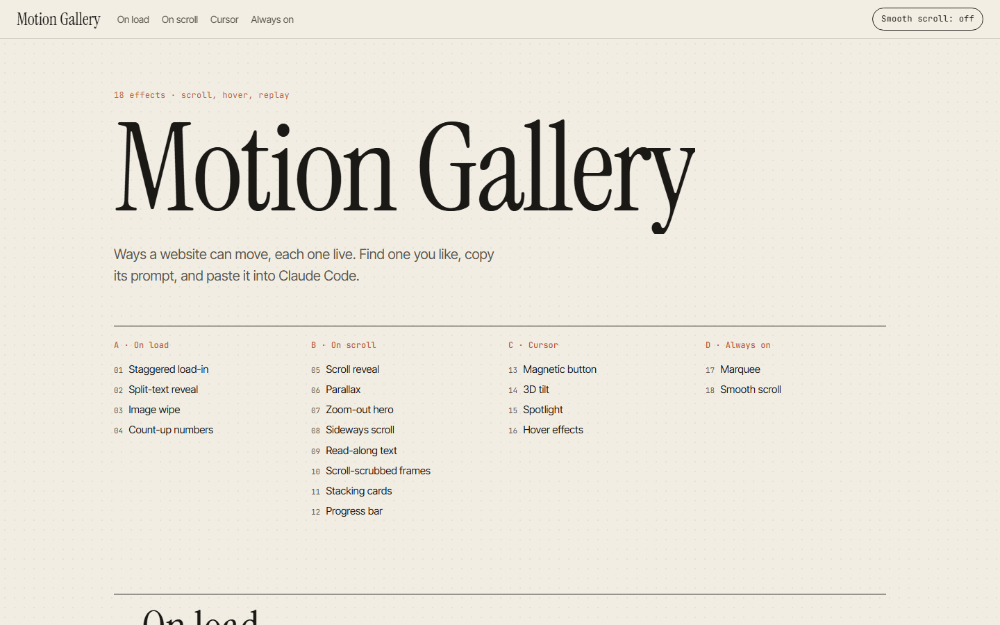
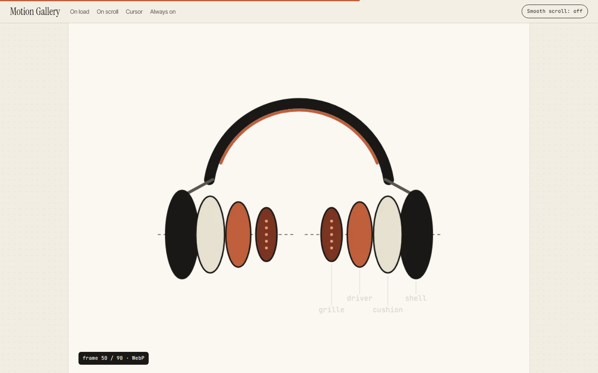

# Motion Gallery

Eighteen ways a website can move, each one live, each with a prompt you can paste into Claude Code.



| Group | Effects |
| --- | --- |
| On load | Staggered load-in · Split-text reveal · Image wipe · Count-up numbers |
| On scroll | Scroll reveal · Parallax · Zoom-out hero · Sideways scroll · Read-along text · Scroll-scrubbed frames · Stacking cards · Progress bar |
| With the cursor | Magnetic button · 3D tilt · Spotlight · Hover effects |
| Always on | Marquee · Smooth scroll |

## Run it

No build step. Open `index.html`, or serve the folder:

```bash
python -m http.server 4620
```

Then open http://localhost:4620.

## How to use it

Scroll through, find an effect you like, and click **Copy prompt**. Paste the prompt into Claude Code in your own project. Every prompt names the tool to use and asks Claude to respect reduced motion.

## Built with

- [GSAP](https://gsap.com) and ScrollTrigger for the animations
- [Lenis](https://github.com/darkroomengineering/lenis) for smooth scroll
- Plain CSS for the hovers and the spotlight

The scroll-scrubbed frames demo draws 90 frames when the page loads and saves them as WebP pictures, then shows the one that matches your scroll position. That's the same flipbook trick you'd use with frames cut from a real video by FFmpeg.



## Files

- `index.html`: the demo for each effect
- `styles.css`: the look
- `gallery.js`: each effect's description and prompt (the `EX` list at the top), then the code for each demo

## License

MIT
